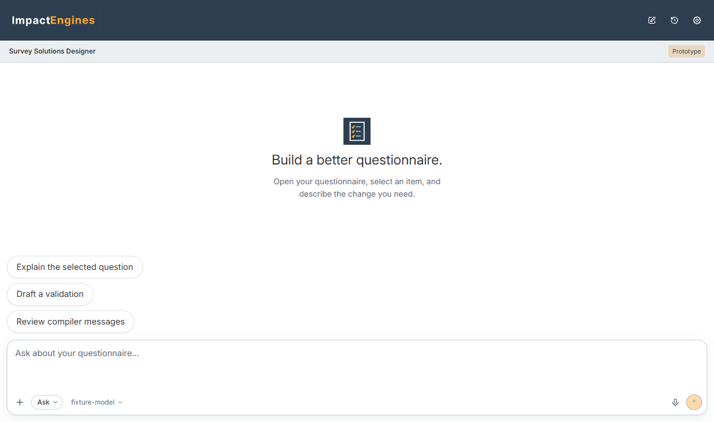

# Impact Engines Designer

Modified by Impact Engines, 19 November 2026. The original upstream README is retained in `docs/upstream-README.md`.

A first prototype assistant for Survey Solutions Designer, built on [NanoBrowser](https://github.com/nanobrowser/nanobrowser). It combines Impact Engines' Survey Solutions programming prompt with a guide developed through live Designer interface testing.

The extension uses your selected model provider and your logged-in browser. It can inspect questions, explain logic, propose and apply edits, use roster context menus, and check compilation results. Dragging is handed back to you. Real LLM performance is still being evaluated; use a disposable questionnaire copy.



## Install the prototype

1. Build from source below, or extract the supplied `impact-engines-designer-0.1.0.zip`.
2. In Chrome, open `chrome://extensions` and enable Developer mode. In Edge, use `edge://extensions`.
3. Choose **Load unpacked** and select the `dist` folder, or the extracted ZIP folder containing `manifest.json`.
4. In the welcome/settings page, connect a tool-capable model using your own provider key. Use a model with **64k or more context**. Keys are entered in the extension, not committed into the source.
5. Open Survey Solutions Designer and a test questionnaire. Open the extension panel with its toolbar icon or **Alt+Shift+I**. Start in Ask mode.

Try **Explain the selected question** first, then request a small explicit validation change. Verify the saved values and compile. See the [live-test checklist](docs/PROTOTYPE-TESTING.md) and [Designer replay suite](docs/DESIGNER-REPLAY-TESTS.md).

## Build

Requires Node 24.22.1 or later in the Node 24 family and pnpm. The project is pinned to pnpm 10.34.7; these commands also work when another pnpm version is installed globally:

```powershell
git clone https://github.com/lbruce-wq/impact-engines-designer.git
cd impact-engines-designer
pnpm dlx pnpm@10.34.7 install --frozen-lockfile
pnpm dlx pnpm@10.34.7 build
```

To create an installable archive:

```powershell
pnpm dlx pnpm@10.34.7 zip
```

The unpacked extension is written to `dist/`; the ZIP is written to `dist-zip/`. Both are generated outputs. Run `pnpm dlx pnpm@10.34.7 prepare-notices` after dependency changes to refresh packaged third-party licence texts.

## What changed from NanoBrowser

- Impact Engines palette, supplied wordmarks, bundled Inter fonts and an original survey-page toolbar glyph.
- Survey-specific onboarding and starter tasks, while retaining NanoBrowser's browser engine, providers and permissions flow.
- Both guides included as built-in instructions, outside the 1,500-character custom-memory field.
- Stable prompt-prefix assembly, an Anthropic cache breakpoint, an OpenAI routing key and provider-reported cache usage in the transcript. See [prompt caching](docs/PROMPT-CACHING.md).
- Production telemetry, upstream store-rating prompts and the upstream uninstall survey disabled.
- Bundled Apache, prompt MIT, Inter OFL and installed third-party licence/notice texts, with attribution in Settings → About.

The [modification record](MODIFICATIONS.md) names changed upstream files. NanoBrowser's original [README](docs/upstream-README.md) and [privacy document](docs/upstream-PRIVACY.md) are retained as historical references; the [prototype privacy policy](PRIVACY.md) describes this fork.

## Checks

```powershell
pnpm dlx pnpm@10.34.7 type-check
pnpm dlx pnpm@10.34.7 lint
pnpm dlx pnpm@10.34.7 test
pnpm dlx pnpm@10.34.7 build
```

Development verification: 945 unit tests passed, 6 opt-in/live tests skipped; browser fixture checks for appearance, chat/reopening and custom instructions passed. Provider request tests use mocked APIs. No real-provider cache hit rate, live LLM Designer replay or production readiness is claimed.

## Limits and privacy

The inherited manifest still has broad host/debugger permissions; Designer-only origin enforcement is not yet implemented. Questionnaire content and messages go to the model provider you choose. Cached input still occupies context, and provider caches do not guarantee lower latency or cost on every request. This prototype does not provide subscriptions, an account backend, PDF/Word ingestion, bulk questionnaire generation or automatic drag-and-drop.

## Attribution and licensing

NanoBrowser code remains under Apache-2.0; the original [LICENSE](LICENSE) is unchanged. The Survey Solutions master prompt is MIT licensed, and Inter uses the SIL Open Font License. Read [NOTICE](NOTICE) and the bundled `public/licenses/` texts for the relevant notices. Impact Engines logos and trademarks remain Impact Engines property and are not licensed by the Apache grant. This project is not affiliated with or endorsed by the World Bank or NanoBrowser.
